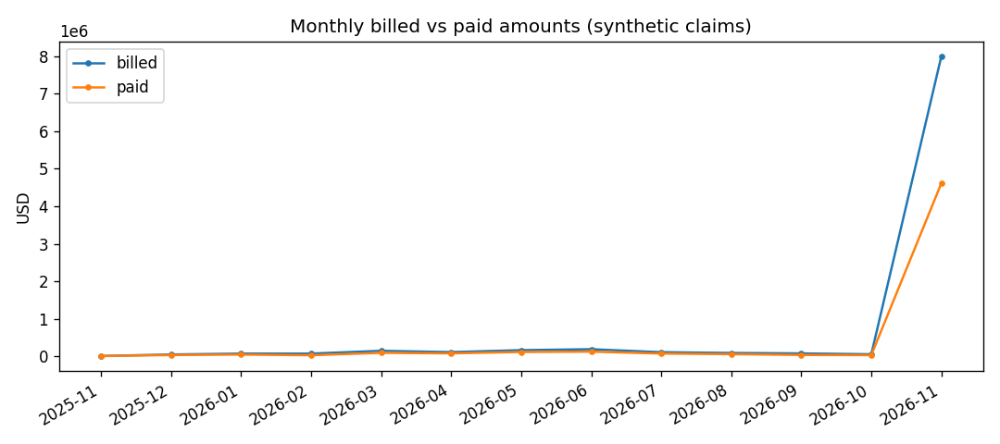
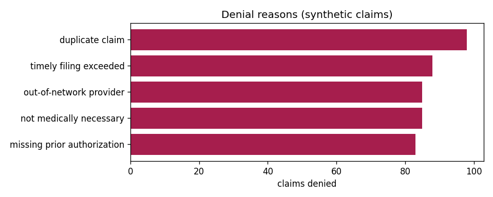

# healthcare-data


A synthetic healthcare **insurance claims** data project: generator, pipeline,
quality checks, marts, visuals and a quick demo. Every record is invented by a
seeded RNG - no real member, patient, provider or plan data anywhere.





## What it does

- `healthdata.claims` - deterministic synthetic claims (plans, procedures,
  diagnoses, billed/allowed/paid amounts, denials with reasons)
- `healthdata.pipeline` - validate, dedupe on `claim_id`, append to a CSV
  store, and build monthly financial marts, denial-reason and plan-mix views
- `healthdata.quality` - amount-consistency, denial-reason, duplicate-grain,
  procedure-range, diagnosis, service-date and member-consistency (one plan and age band per member) checks that fail loudly
- `healthdata.report` - markdown report plus charts. Sections include plan
  performance and cost sharing, denial reasons (and the procedures behind them),
  plan x month denial-rate outliers, paid-amount concentration, cost by age
  band, month-over-month trend, potential duplicate services and a per-check
  data quality gate table
- `healthdata.cli` - read-only lookups: claim, member, plan, procedure, diagnosis
- `scripts/daily_update.py` - one update round: fresh synthetic batch, quality
  gates, regenerated report. Each run adds a new sequenced batch (claim ids
  carry a -Bnn- segment), so multiple rounds a day all bring new data;
  pipeline dedupe still prevents double-ingesting an identical batch

## Try it

```bash
pip install -r requirements.txt
python examples/quick_demo.py       # 500 synthetic claims through the pipeline
python scripts/daily_update.py      # full update round with quality gates
python scripts/query.py member MBR-0076   # claim / member / plan / procedure / diagnosis lookups
python -m pytest                    # offline test suite
```

The latest generated report lives at
[reports/claims_report.md](reports/claims_report.md).

## Data

**Provenance.** The store has a `data_origin` column. On 2026-11-21 older synthetic
history was repaired in place: early batches gave one member different plans and age
bands on different claims, and some pediatric rows carried adult-only procedures.
Repaired rows are tagged `regenerated-2026-11-21` (billed re-drawn in the procedure's
range for changed procedures, allowed/paid ratios and denial status kept); claims
generated under the current rules are `generated`. Earlier per-member and per-plan
figures from before that date are superseded. The report lists the counts.

All synthetic, from `healthdata.claims.ClaimGenerator` with a fixed seed per
run. Amounts follow simple rules (paid <= allowed <= billed; denied claims pay
nothing) so the marts and quality checks have realistic invariants to enforce.
The procedure/diagnosis codes, plan types, denial reasons and payment rules are
illustrative teaching examples - they are not authoritative coding, coverage
or adjudication logic, and nothing here is medical, financial or insurance
advice.
