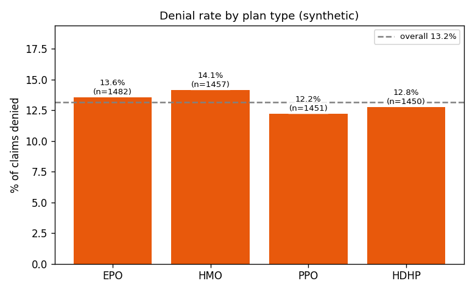

# Healthcare Data - claims pipeline report

Generated 2026-11-24 20:46 UTC. All data is synthetic - no real member, patient or plan information.

**5840 claims** in store. Billed $14,669,623, paid $8,323,371, denied 769 overall.

## Monthly financials

Monthly counts here are shaped by the synthetic generator (daily batches spread service dates over the trailing 90 days; months before that are a sparse backfill), not evidence of utilization trends.

| Month | Claims | Billed | Allowed | Paid | Denial rate |
| --- | ---: | ---: | ---: | ---: | ---: |
| 2025-11 | 18 | $5,840 | $4,755 | $4,019 | 11.1% |
| 2025-12 | 44 | $45,779 | $36,033 | $31,423 | 9.1% |
| 2026-01 | 31 | $69,438 | $54,037 | $43,702 | 0.0% |
| 2026-02 | 32 | $69,848 | $53,159 | $26,265 | 12.5% |
| 2026-03 | 45 | $144,754 | $103,258 | $90,177 | 11.1% |
| 2026-04 | 48 | $109,782 | $90,132 | $76,083 | 8.3% |
| 2026-05 | 43 | $161,609 | $121,321 | $113,180 | 11.6% |
| 2026-06 | 46 | $186,994 | $150,110 | $122,054 | 15.2% |
| 2026-07 | 47 | $107,464 | $88,764 | $71,460 | 8.5% |
| 2026-08 | 587 | $1,553,249 | $1,190,066 | $873,735 | 12.3% |
| 2026-09 | 1820 | $4,508,381 | $3,461,087 | $2,618,333 | 13.4% |
| 2026-10 | 1825 | $4,280,927 | $3,238,096 | $2,404,874 | 13.9% |
| 2026-11 | 1254 | $3,425,556 | $2,588,250 | $1,848,066 | 13.1% |

## Service-date distribution

Share of stored claims per service month. Generator-shaped: new batches spread dates over 90 days and older single-date batches were redistributed, so months before the spread are thin backfill. A quality gate caps any month at 50%.

| Month | Claims | Share |
| --- | ---: | ---: |
| 2025-11 | 18 | 0.3% |
| 2025-12 | 44 | 0.8% |
| 2026-01 | 31 | 0.5% |
| 2026-02 | 32 | 0.5% |
| 2026-03 | 45 | 0.8% |
| 2026-04 | 48 | 0.8% |
| 2026-05 | 43 | 0.7% |
| 2026-06 | 46 | 0.8% |
| 2026-07 | 47 | 0.8% |
| 2026-08 | 587 | 10.1% |
| 2026-09 | 1820 | 31.2% |
| 2026-10 (largest) | 1825 | 31.2% |
| 2026-11 | 1254 | 21.5% |

## Top diagnoses by paid amount

Illustrative code list, not authoritative coding; synthetic data.

| Diagnosis | Description | Claims | Avg billed | Paid | Denial rate |
| --- | --- | ---: | ---: | ---: | ---: |
| I10 | Essential hypertension | 1023 | $2,651 | $1,557,392 | 12.5% |
| R51 | Headache | 1056 | $2,524 | $1,416,037 | 13.9% |
| Z00.00 | General adult medical exam | 757 | $2,993 | $1,372,482 | 14.0% |
| J06.9 | Acute upper respiratory infection | 1018 | $2,417 | $1,350,431 | 13.1% |
| M54.5 | Low back pain | 1001 | $2,281 | $1,327,697 | 12.7% |
| E11.9 | Type 2 diabetes without complications | 985 | $2,318 | $1,299,332 | 13.0% |

## Most common diagnosis/procedure pairs

Pairs come from independent synthetic draws: this shows the generator's mix, not clinical practice. Illustrative codes.

| Diagnosis | Procedure | Claims | Denial rate | Paid |
| --- | --- | ---: | ---: | ---: |
| R51 | 93000 | 123 | 8.1% | $7,152 |
| R51 | 80053 | 120 | 11.7% | $5,756 |
| J06.9 | 93000 | 119 | 15.1% | $6,756 |
| M54.5 | 99285 | 119 | 16.0% | $72,490 |
| R51 | 43239 | 113 | 17.7% | $122,442 |
| E11.9 | 99213 | 112 | 16.1% | $7,307 |

## Claim status breakdown

| Status | Claims | Share | Billed | Paid |
| --- | ---: | ---: | ---: | ---: |
| paid | 4491 | 76.9% | $10,997,927 | $7,211,403 |
| adjusted | 580 | 9.9% | $1,733,273 | $1,111,968 |
| denied | 769 | 13.2% | $1,938,424 | $0 |

## Leading denial reason by month

Months with fewer than 10 denials are omitted. Most synthetic claims fall in the latest service month, so older months are sparse. Synthetic data.

| Month | Denials | Leading reason | Share of denials |
| --- | ---: | --- | ---: |
| 2026-08 | 72 | not medically necessary | 27.8% |
| 2026-09 | 244 | missing prior authorization | 27.5% |
| 2026-10 | 254 | missing prior authorization | 26.4% |
| 2026-11 | 164 | timely filing exceeded | 25.6% |

## Denial reasons

- out-of-network provider (185)
- timely filing exceeded (185)
- not medically necessary (182)
- missing prior authorization (180)
- duplicate claim (37)

## Plan mix

- EPO: 1482
- HMO: 1457
- PPO: 1451
- HDHP: 1450

## Plan performance

| Plan | Claims | Denial rate | Paid / billed |
| --- | ---: | ---: | ---: |
| EPO | 1482 | 13.6% | 55.3% |
| HMO | 1457 | 14.1% | 56.3% |
| PPO | 1451 | 12.2% | 55.1% |
| HDHP | 1450 | 12.8% | 59.8% |

## Cost sharing by plan (non-denied claims)

Network discount = 1 - allowed/billed. Member cost share = (allowed - paid)/allowed. Illustrative synthetic rules, not real benefit design.

| Plan | Claims | Network discount | Member cost share |
| --- | ---: | ---: | ---: |
| HMO | 1251 | 22.7% | 15.6% |
| PPO | 1274 | 24.1% | 15.3% |
| HDHP | 1265 | 22.1% | 14.8% |
| EPO | 1281 | 23.4% | 14.7% |

## Denial-rate outliers (plan x month)

Cells whose denial rate is at least 2 standard errors from the overall rate (cells under 20 claims skipped). A statistical screen on synthetic data, not a finding. Monthly counts here are shaped by the synthetic generator (daily batches spread service dates over the trailing 90 days; months before that are a sparse backfill), not evidence of utilization trends.

No plan/month cells outside the screen.

## Denied dollars by reason

Billed amount on denied claims. A reason with few claims can still carry a large share when it lands on expensive procedures. Synthetic, illustrative.

| Reason | Claims | Billed | Share | Avg billed |
| --- | ---: | ---: | ---: | ---: |
| missing prior authorization | 180 | $501,343 | 25.9% | $2,785 |
| not medically necessary | 182 | $467,344 | 24.1% | $2,568 |
| timely filing exceeded | 185 | $448,734 | 23.2% | $2,426 |
| out-of-network provider | 185 | $389,536 | 20.1% | $2,106 |
| duplicate claim | 37 | $131,466 | 6.8% | $3,553 |

## Duplicate-claim leakage screen

In each same member/procedure/date group the first claim is the original. A review queue, not proof: repeat services can be legitimate. In this synthetic data older repeats are chance collisions of random fields (mostly paid), while newer batches add deliberate repeats, most denied as duplicate and some paid. Illustrative, not real payment-integrity rates.

- Groups with repeats: 134 (143 later claims)
- Later claims denied as duplicate: 37
- Later claims still paid: 96 ($209,577 to review)
- Claims denied as duplicate with no matching original: 0

## Members by number of claims

How many claims each synthetic member has, and where paid dollars sit. Members with no claims are not visible (no enrollment data). Illustrative.

| Claims per member | Members | % of members | Paid | % of paid |
| --- | ---: | ---: | ---: | ---: |
| 1 claim | 317 | 16.9% | $310,184 | 3.7% |
| 2 claims | 447 | 23.8% | $1,199,380 | 14.4% |
| 3 claims | 434 | 23.2% | $1,890,357 | 22.7% |
| 4+ claims | 676 | 36.1% | $4,923,451 | 59.2% |

## Claims by billed-amount band

Share of claims versus share of paid dollars. Band edges are illustrative; synthetic data.

| Billed band | Claims | % of claims | Paid | % of paid | Denial rate |
| --- | ---: | ---: | ---: | ---: | ---: |
| under $100 | 1708 | 29.2% | $67,415 | 0.8% | 12.7% |
| $100-$999 | 2703 | 46.3% | $489,880 | 5.9% | 13.5% |
| $1,000-$9,999 | 943 | 16.2% | $934,236 | 11.2% | 13.2% |
| $10,000+ | 486 | 8.3% | $6,831,841 | 82.1% | 13.2% |

## Aggregate reconciliation

Every view accounts for the whole store.

| Check | View | Store | Match |
| --- | ---: | ---: | :---: |
| claims: monthly view | 5,840 | 5,840 | yes |
| claims: plan mix | 5,840 | 5,840 | yes |
| claims: plan performance | 5,840 | 5,840 | yes |
| claims: age bands | 5,840 | 5,840 | yes |
| claims: cost per member | 5,840 | 5,840 | yes |
| paid $: monthly view | 8,323,371.25 | 8,323,371.25 | yes |
| paid $: age bands | 8,323,378.85 | 8,323,371.25 | yes |
| denied claims: reasons | 769 | 769 | yes |

## Data provenance

`data_origin` marks how each stored claim came to be. Rows tagged `regenerated-*` are older synthetic history that was repaired in place (one plan and age band per member, no age-implausible procedure or diagnosis, and "duplicate claim" denials without an earlier matching claim given another reason; a `+2026-11-22` suffix marks the second repair); `generated` rows were produced under the current rules. Tagged counts are conservative, not an exact count of changed rows: the whole B05 batch is tagged even if a few of its rows already matched. Plan and age band are labels only, with no plan-specific benefits or clinical realism. A `+2026-11-23` suffix marks service dates redistributed over the trailing 90 days (only service_date moved; see docs/service-date-redistribution.md). All of it is synthetic.

| Origin | Claims |
| --- | ---: |
| generated | 703 |
| regenerated-2026-11-21 | 553 |
| regenerated-2026-11-21+2026-11-22 | 12 |
| regenerated-2026-11-21+2026-11-22+2026-11-23 | 71 |
| regenerated-2026-11-21+2026-11-23 | 2667 |
| regenerated-2026-11-22 | 1 |
| regenerated-2026-11-22+2026-11-23 | 33 |
| regenerated-2026-11-23 | 1800 |

## Cost per member by plan

Distinct synthetic members, claims and paid dollars per member in the store. Not a true PMPM: there is no enrollment data. Illustrative only.

| Plan | Members | Claims | Claims / member | Paid / member |
| --- | ---: | ---: | ---: | ---: |
| HDHP | 450 | 1450 | 3.22 | $5,590 |
| PPO | 476 | 1451 | 3.05 | $4,467 |
| EPO | 479 | 1482 | 3.09 | $4,113 |
| HMO | 469 | 1457 | 3.11 | $3,649 |

## Members with repeated denials

Synthetic member ids with the most denied claims. Illustrative only: the data is random, so this shows the report shape, not a real pattern.

| Member | Claims | Denied | Denial rate |
| --- | ---: | ---: | ---: |
| MBR-1168 | 5 | 4 | 80.0% |
| MBR-0961 | 9 | 4 | 44.4% |
| MBR-1023 | 3 | 3 | 100.0% |
| MBR-0825 | 4 | 3 | 75.0% |
| MBR-0912 | 4 | 3 | 75.0% |

## Allowed-to-billed ratio by procedure

Lowest ratios first (non-denied claims, procedures with enough volume). A lower ratio means a bigger gap between billed charges and the allowed amount. Synthetic and illustrative, not real contract rates.

| Procedure | Claims | Billed | Allowed | Allowed / billed |
| --- | ---: | ---: | ---: | ---: |
| 43239 | 515 | $1,055,408 | $809,221 | 76.7% |
| 27447 | 422 | $10,443,689 | $8,033,397 | 76.9% |
| 99213 | 528 | $63,526 | $49,123 | 77.3% |
| 85025 | 502 | $26,828 | $20,770 | 77.4% |
| 99214 | 512 | $85,598 | $66,322 | 77.5% |
| 70450 | 510 | $333,768 | $258,680 | 77.5% |

## Paid-amount concentration

Share of total paid (5840 claims) held by the largest claims. Synthetic data, illustrative.

| Top claims | Count | Share of paid |
| --- | ---: | ---: |
| top 1% | 59 | 17.0% |
| top 5% | 292 | 64.6% |
| top 10% | 584 | 85.6% |

## Procedures behind the top denial reasons

| Denial reason | Denials | Top procedures (share of that reason) |
| --- | ---: | --- |
| out-of-network provider | 185 | 80053 (14%), 99285 (14%), 93000 (12%) |
| timely filing exceeded | 185 | 99213 (13%), 93000 (12%), 97110 (10%) |
| not medically necessary | 182 | 43239 (14%), 93000 (13%), 99285 (13%) |

## Data quality gates

10 of 10 checks passed on this run.

| Check | Issues | Result |
| --- | ---: | --- |
| amount consistency | 0 | pass |
| denial reasons | 0 | pass |
| one member per claim | 0 | pass |
| billed within procedure range | 0 | pass |
| known diagnosis codes | 0 | pass |
| service dates | 0 | pass |
| member consistency | 0 | pass |
| age plausibility | 0 | pass |
| duplicate denials supported | 0 | pass |
| service month concentration | 0 | pass |

## Top procedures by paid amount

| Code | Claims | Avg billed | Paid | Denial rate |
| --- | ---: | ---: | ---: | ---: |
| 27447 | 486 | $24,775 | $6,831,841 | 13.2% |
| 43239 | 594 | $2,042 | $682,322 | 13.3% |
| 99285 | 623 | $1,060 | $374,521 | 14.4% |
| 70450 | 579 | $650 | $218,455 | 11.9% |
| 99214 | 585 | $168 | $56,407 | 12.5% |

## Member utilization

1110 of 1874 synthetic members have 3+ claims and account for 81.9% of paid dollars.

| Member | Claims | Paid |
| --- | ---: | ---: |
| MBR-1200 | 12 | $1,453 |
| MBR-0124 | 10 | $16,536 |
| MBR-0136 | 9 | $4,111 |
| MBR-0961 | 9 | $3,263 |
| MBR-0154 | 8 | $27,766 |

## Top denial reason by plan

| Plan | Denials | Top reason | Count |
| --- | ---: | --- | ---: |
| EPO | 201 | out-of-network provider | 50 |
| HDHP | 185 | missing prior authorization | 48 |
| HMO | 206 | not medically necessary | 52 |
| PPO | 177 | not medically necessary | 45 |

## Plan denial rates with 95% intervals

Wilson score intervals. The generator draws denials at the same rate for every plan, so overlap with the overall rate is expected; plan labels carry no benefit realism.

| Plan | Claims | Denial rate | 95% interval | Differs from overall |
| --- | ---: | ---: | --- | --- |
| EPO | 1482 | 13.6% | 11.9% to 15.4% | no |
| HMO | 1457 | 14.1% | 12.4% to 16.0% | no |
| PPO | 1451 | 12.2% | 10.6% to 14.0% | no |
| HDHP | 1450 | 12.8% | 11.1% to 14.6% | no |

## Member denial experience

Members with 3+ claims (1110). Denials are random draws in the generator, so this is a profile of the synthetic data, not member behavior.

| Denials | Members | Share |
| --- | ---: | ---: |
| no denials | 643 | 57.9% |
| 1 denial | 344 | 31.0% |
| 2+ denials | 123 | 11.1% |

## Denials by age band

Age band is a synthetic per-member label with no clinical or benefit realism; differences come from the generator's random draws.

| Age band | Claims | Denied | Denial rate | Top reason |
| --- | ---: | ---: | ---: | --- |
| 0-17 | 994 | 110 | 11.1% | missing prior authorization |
| 18-29 | 900 | 117 | 13.0% | timely filing exceeded |
| 30-44 | 984 | 134 | 13.6% | not medically necessary |
| 45-59 | 961 | 131 | 13.6% | out-of-network provider |
| 60-74 | 1011 | 123 | 12.2% | not medically necessary |
| 75+ | 990 | 154 | 15.6% | missing prior authorization |

## Month-over-month trend (last 6 complete months)

Monthly counts here are shaped by the synthetic generator (daily batches spread service dates over the trailing 90 days; months before that are a sparse backfill), not evidence of utilization trends.

| Month | Claims | Paid | Denial rate |
| --- | ---: | ---: | ---: |
| 2026-05 | -10.4% | +48.8% | +3.30 pp |
| 2026-06 | +7.0% | +7.8% | +3.59 pp |
| 2026-07 | +2.2% | -41.4% | -6.71 pp |
| 2026-08 | +1148.9% | +1122.7% | +3.76 pp |
| 2026-09 | +210.0% | +199.7% | +1.14 pp |
| 2026-10 | +0.3% | -8.2% | +0.51 pp |

## Potential duplicate services

134 groups share a member, procedure and service date (review queue, not a quality failure).

| Member | Procedure | Date | Claims | Paid |
| --- | --- | --- | ---: | ---: |
| MBR-1973 | 27447 | 2026-10-13 | 3 | $55,302 |
| MBR-0743 | 27447 | 2026-08-29 | 2 | $54,807 |
| MBR-0076 | 27447 | 2026-10-19 | 2 | $35,616 |
| MBR-0200 | 27447 | 2026-11-02 | 2 | $35,600 |
| MBR-1150 | 27447 | 2026-08-30 | 2 | $33,395 |

## Cost by age band

Synthetic data generated by `healthdata.claims.ClaimGenerator`. Codes, plan types and payment rules are illustrative examples, not authoritative coding or adjudication logic. Not medical, financial or insurance advice.
