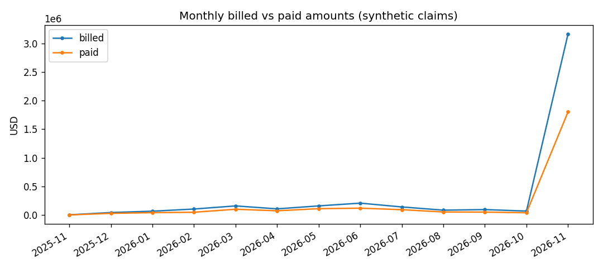

# Healthcare Data - claims pipeline report

Generated 2026-11-18 09:08 UTC. All data is synthetic - no real member, patient or plan information.

**1520 claims** in store. Billed $4,431,586, paid $2,594,257, denied 155 overall.

## Monthly financials

| Month | Claims | Billed | Allowed | Paid | Denial rate |
| --- | ---: | ---: | ---: | ---: | ---: |
| 2025-11 | 18 | $5,840 | $4,755 | $4,019 | 11.1% |
| 2025-12 | 44 | $45,779 | $36,033 | $31,423 | 9.1% |
| 2026-01 | 31 | $69,438 | $54,037 | $43,702 | 0.0% |
| 2026-02 | 32 | $106,824 | $80,818 | $51,105 | 12.5% |
| 2026-03 | 45 | $161,580 | $117,994 | $103,125 | 11.1% |
| 2026-04 | 48 | $109,782 | $90,132 | $76,083 | 8.3% |
| 2026-05 | 43 | $161,609 | $121,321 | $113,180 | 11.6% |
| 2026-06 | 46 | $209,778 | $171,530 | $122,054 | 15.2% |
| 2026-07 | 47 | $143,413 | $117,048 | $95,614 | 8.5% |
| 2026-08 | 50 | $87,251 | $70,911 | $55,220 | 18.0% |
| 2026-09 | 28 | $97,162 | $80,729 | $53,482 | 7.1% |
| 2026-10 | 47 | $71,505 | $55,063 | $42,442 | 8.5% |
| 2026-11 | 1041 | $3,161,624 | $2,438,863 | $1,802,808 | 10.2% |

## Denial reasons

- not medically necessary (38)
- timely filing exceeded (33)
- duplicate claim (33)
- missing prior authorization (26)
- out-of-network provider (26)

## Plan mix

- HMO: 413
- PPO: 393
- EPO: 374
- HDHP: 340

## Plan performance

| Plan | Claims | Denial rate | Paid / billed |
| --- | ---: | ---: | ---: |
| HMO | 413 | 9.4% | 62.8% |
| PPO | 393 | 12.0% | 54.4% |
| EPO | 374 | 11.0% | 55.5% |
| HDHP | 340 | 8.5% | 61.4% |

## Top procedures by paid amount

| Code | Claims | Avg billed | Paid | Denial rate |
| --- | ---: | ---: | ---: | ---: |
| 27447 | 149 | $25,130 | $2,195,863 | 10.1% |
| 43239 | 161 | $2,054 | $190,170 | 10.6% |
| 99285 | 153 | $1,061 | $91,140 | 12.4% |
| 70450 | 149 | $668 | $60,780 | 6.7% |
| 99214 | 142 | $167 | $13,609 | 12.7% |

## Member utilization

100 of 1055 synthetic members have 3+ claims and account for 19.3% of paid dollars.

| Member | Claims | Paid |
| --- | ---: | ---: |
| MBR-1424 | 5 | $14,713 |
| MBR-0746 | 5 | $11,386 |
| MBR-1542 | 4 | $27,681 |
| MBR-0471 | 4 | $16,601 |
| MBR-1166 | 4 | $14,618 |

## Top denial reason by plan

| Plan | Denials | Top reason | Count |
| --- | ---: | --- | ---: |
| EPO | 41 | not medically necessary | 11 |
| HDHP | 29 | not medically necessary | 7 |
| HMO | 39 | not medically necessary | 11 |
| PPO | 47 | timely filing exceeded | 14 |

## Potential duplicate services

17 groups share a member, procedure and service date (review queue, not a quality failure).

| Member | Procedure | Date | Claims | Paid |
| --- | --- | --- | ---: | ---: |
| MBR-0076 | 27447 | 2026-11-17 | 2 | $35,616 |
| MBR-1695 | 27447 | 2026-11-18 | 2 | $25,258 |
| MBR-1025 | 27447 | 2026-11-17 | 2 | $23,763 |
| MBR-1697 | 43239 | 2026-11-17 | 2 | $2,808 |
| MBR-1896 | 43239 | 2026-11-17 | 2 | $2,471 |

## Cost by age band

Synthetic data generated by `healthdata.claims.ClaimGenerator`. Codes, plan types and payment rules are illustrative examples, not authoritative coding or adjudication logic. Not medical, financial or insurance advice.
