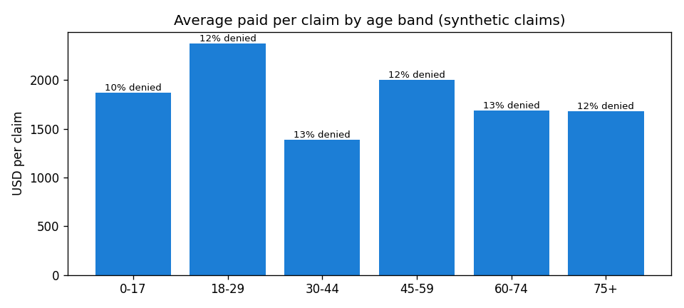
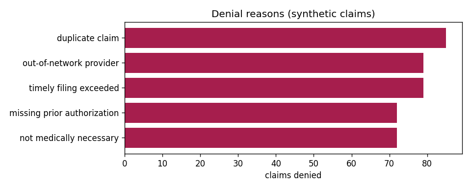

# Healthcare Data - claims pipeline report

Generated 2026-11-21 07:17 UTC. All data is synthetic - no real member, patient or plan information.

**3260 claims** in store. Billed $10,155,915, paid $5,981,111, denied 387 overall.

## Monthly financials

| Month | Claims | Billed | Allowed | Paid | Denial rate |
| --- | ---: | ---: | ---: | ---: | ---: |
| 2025-11 | 18 | $5,840 | $4,755 | $4,019 | 11.1% |
| 2025-12 | 44 | $45,779 | $36,033 | $31,423 | 9.1% |
| 2026-01 | 31 | $69,438 | $54,037 | $43,702 | 0.0% |
| 2026-02 | 32 | $106,824 | $80,818 | $51,105 | 12.5% |
| 2026-03 | 45 | $161,580 | $117,994 | $103,125 | 11.1% |
| 2026-04 | 48 | $109,782 | $90,132 | $76,083 | 8.3% |
| 2026-05 | 43 | $161,609 | $121,321 | $113,180 | 11.6% |
| 2026-06 | 46 | $209,778 | $171,530 | $122,054 | 15.2% |
| 2026-07 | 47 | $143,413 | $117,048 | $95,614 | 8.5% |
| 2026-08 | 50 | $87,251 | $70,911 | $55,220 | 18.0% |
| 2026-09 | 28 | $97,162 | $80,729 | $53,482 | 7.1% |
| 2026-10 | 47 | $71,505 | $55,063 | $42,442 | 8.5% |
| 2026-11 | 2781 | $8,885,952 | $6,878,400 | $5,189,661 | 12.1% |

## Denial reasons

- duplicate claim (85)
- out-of-network provider (79)
- timely filing exceeded (79)
- missing prior authorization (72)
- not medically necessary (72)

## Plan mix

- HMO: 869
- PPO: 813
- HDHP: 813
- EPO: 765

## Plan performance

| Plan | Claims | Denial rate | Paid / billed |
| --- | ---: | ---: | ---: |
| HMO | 869 | 10.8% | 61.4% |
| HDHP | 813 | 11.3% | 59.5% |
| PPO | 813 | 11.3% | 58.6% |
| EPO | 765 | 14.2% | 55.9% |

## Cost sharing by plan (non-denied claims)

Network discount = 1 - allowed/billed. Member cost share = (allowed - paid)/allowed. Illustrative synthetic rules, not real benefit design.

| Plan | Claims | Network discount | Member cost share |
| --- | ---: | ---: | ---: |
| PPO | 721 | 22.4% | 15.4% |
| EPO | 656 | 23.6% | 15.4% |
| HDHP | 721 | 22.1% | 15.0% |
| HMO | 775 | 22.1% | 14.9% |

## Denial-rate outliers (plan x month)

Cells whose denial rate is at least 2 standard errors from the overall rate (cells under 20 claims skipped). A statistical screen on synthetic data, not a finding.

| Plan | Month | Claims | Denial rate | Overall | z |
| --- | --- | ---: | ---: | ---: | ---: |
| EPO | 2026-11 | 645 | 14.7% | 11.9% | +2.24 |

## Denied dollars by reason

Billed amount on denied claims. A reason with few claims can still carry a large share when it lands on expensive procedures. Synthetic, illustrative.

| Reason | Claims | Billed | Share | Avg billed |
| --- | ---: | ---: | ---: | ---: |
| timely filing exceeded | 79 | $299,961 | 28.5% | $3,797 |
| not medically necessary | 72 | $238,244 | 22.6% | $3,309 |
| missing prior authorization | 72 | $190,838 | 18.1% | $2,651 |
| duplicate claim | 85 | $175,643 | 16.7% | $2,066 |
| out-of-network provider | 79 | $147,637 | 14.0% | $1,869 |

## Members with repeated denials

Synthetic member ids with the most denied claims. Illustrative only: the data is random, so this shows the report shape, not a real pattern.

| Member | Claims | Denied | Denial rate |
| --- | ---: | ---: | ---: |
| MBR-1168 | 5 | 4 | 80.0% |
| MBR-0961 | 6 | 3 | 50.0% |

## Allowed-to-billed ratio by procedure

Lowest ratios first (non-denied claims, procedures with enough volume). A lower ratio means a bigger gap between billed charges and the allowed amount. Synthetic and illustrative, not real contract rates.

| Procedure | Claims | Billed | Allowed | Allowed / billed |
| --- | ---: | ---: | ---: | ---: |
| 99214 | 279 | $46,481 | $35,728 | 76.9% |
| 99213 | 291 | $34,952 | $26,889 | 76.9% |
| 43239 | 281 | $576,027 | $444,802 | 77.2% |
| 27447 | 315 | $7,839,754 | $6,071,527 | 77.5% |
| 93000 | 285 | $28,956 | $22,450 | 77.5% |
| 99285 | 298 | $321,244 | $249,379 | 77.6% |

## Paid-amount concentration

Share of total paid (3260 claims) held by the largest claims. Synthetic data, illustrative.

| Top claims | Count | Share of paid |
| --- | ---: | ---: |
| top 1% | 33 | 13.5% |
| top 5% | 163 | 54.3% |
| top 10% | 326 | 86.6% |

## Procedures behind the top denial reasons

| Denial reason | Denials | Top procedures (share of that reason) |
| --- | ---: | --- |
| duplicate claim | 85 | 99285 (20%), 93000 (13%), 70450 (11%) |
| out-of-network provider | 79 | 70450 (14%), 99285 (14%), 43239 (13%) |
| timely filing exceeded | 79 | 27447 (14%), 99214 (13%), 85025 (11%) |

## Data quality gates

6 of 6 checks passed on this run.

| Check | Issues | Result |
| --- | ---: | --- |
| amount consistency | 0 | pass |
| denial reasons | 0 | pass |
| one member per claim | 0 | pass |
| billed within procedure range | 0 | pass |
| known diagnosis codes | 0 | pass |
| service dates | 0 | pass |

## Top procedures by paid amount

| Code | Claims | Avg billed | Paid | Denial rate |
| --- | ---: | ---: | ---: | ---: |
| 27447 | 349 | $24,943 | $5,156,803 | 9.7% |
| 43239 | 326 | $2,039 | $373,423 | 13.8% |
| 99285 | 347 | $1,072 | $210,602 | 14.1% |
| 70450 | 321 | $654 | $122,120 | 11.5% |
| 99214 | 325 | $167 | $30,203 | 14.1% |

## Member utilization

454 of 1598 synthetic members have 3+ claims and account for 50.7% of paid dollars.

| Member | Claims | Paid |
| --- | ---: | ---: |
| MBR-1200 | 8 | $473 |
| MBR-1219 | 6 | $35,318 |
| MBR-0693 | 6 | $30,518 |
| MBR-0471 | 6 | $28,114 |
| MBR-0154 | 6 | $27,628 |

## Top denial reason by plan

| Plan | Denials | Top reason | Count |
| --- | ---: | --- | ---: |
| EPO | 109 | duplicate claim | 29 |
| HDHP | 92 | out-of-network provider | 23 |
| HMO | 94 | duplicate claim | 20 |
| PPO | 92 | timely filing exceeded | 23 |

## Month-over-month trend (last 6 complete months)

| Month | Claims | Paid | Denial rate |
| --- | ---: | ---: | ---: |
| 2026-05 | -10.4% | +48.8% | +3.30 pp |
| 2026-06 | +7.0% | +7.8% | +3.59 pp |
| 2026-07 | +2.2% | -21.7% | -6.71 pp |
| 2026-08 | +6.4% | -42.2% | +9.49 pp |
| 2026-09 | -44.0% | -3.1% | -10.86 pp |
| 2026-10 | +67.9% | -20.6% | +1.37 pp |

## Potential duplicate services

46 groups share a member, procedure and service date (review queue, not a quality failure).

| Member | Procedure | Date | Claims | Paid |
| --- | --- | --- | ---: | ---: |
| MBR-1973 | 27447 | 2026-11-18 | 3 | $55,302 |
| MBR-0076 | 27447 | 2026-11-17 | 2 | $35,616 |
| MBR-1695 | 27447 | 2026-11-18 | 2 | $25,258 |
| MBR-1025 | 27447 | 2026-11-17 | 2 | $23,763 |
| MBR-1697 | 43239 | 2026-11-17 | 2 | $2,808 |

## Cost by age band

Synthetic data generated by `healthdata.claims.ClaimGenerator`. Codes, plan types and payment rules are illustrative examples, not authoritative coding or adjudication logic. Not medical, financial or insurance advice.
